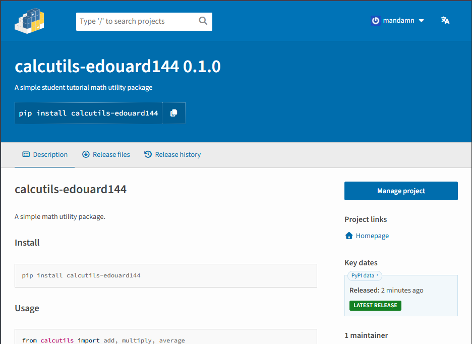

# calcutils-edouard144


A simple math utility package.

## Install

```
pip install calcutils-edouard144
```

## Usage

```python
from calcutils import add, multiply, average

add(10, 25)              # 35
multiply(3, 4)           # 12
average([10, 20, 30])    # 20.0
```